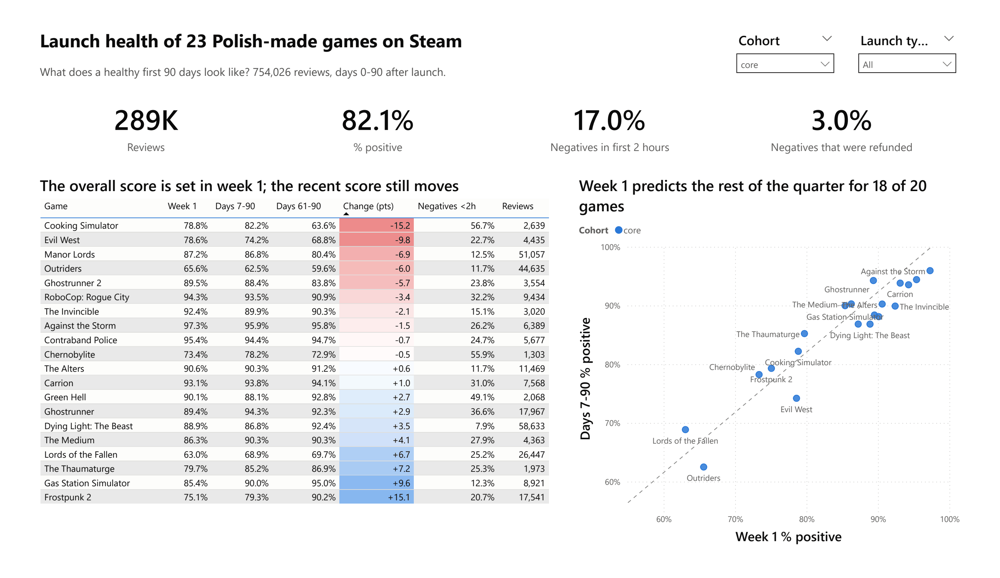
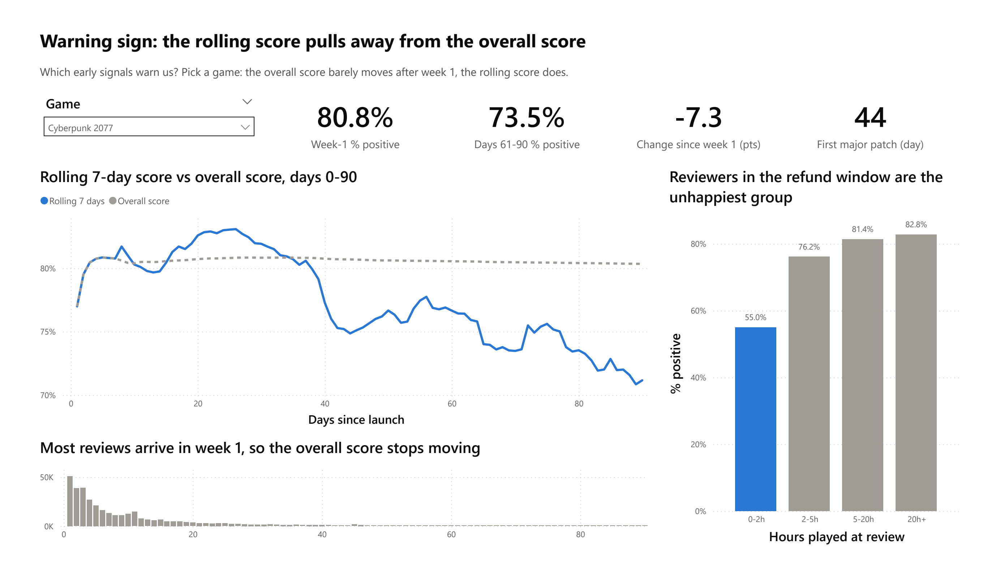
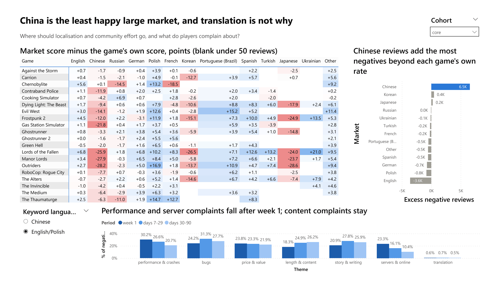
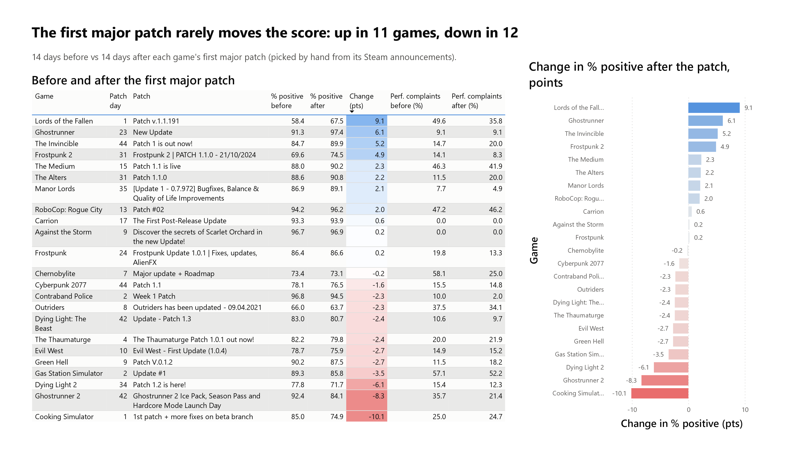
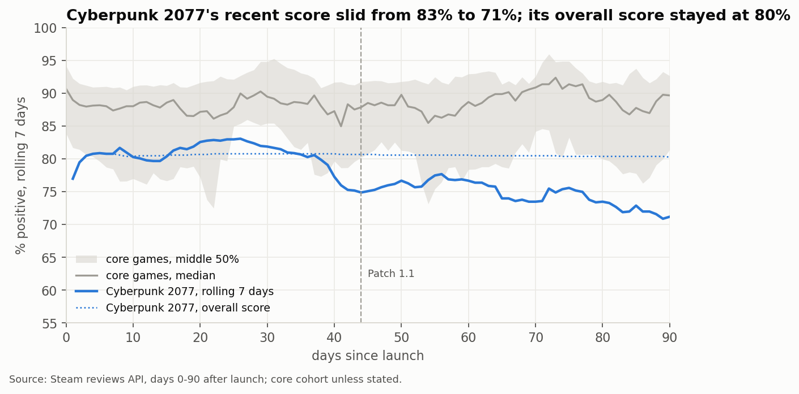

# Launch health of Polish-made games on Steam

**What does a healthy first 90 days on Steam look like for games like ours, and which early signals warn us that the rating is going wrong?**

An analysis of 754,026 Steam reviews from 23 Polish-made games, covering launch day to day 90. It is written for a mid-sized Polish publisher planning its next release. The pipeline uses Python for collection and cleaning, PostgreSQL for the analysis views, and pandas and Power BI for the analysis and dashboard.

- 📄 **[One-page executive summary (PDF)](docs/executive_summary.pdf)**
- 📊 **[Interactive dashboard on Tableau Public](https://public.tableau.com/app/profile/jakub.siuda/viz/LaunchhealthofPolish-madegamesonSteam/Portfoliooverview)**
- 📓 **[Analysis notebook on Kaggle](https://www.kaggle.com/code/jakubsiuda/launch-health-of-polish-made-games-on-steam)** (runs in the browser on the exported views)
- 🗂️ **[Dataset on Kaggle](https://www.kaggle.com/datasets/jakubsiuda/polish-made-games-on-steam-first-90-days)**



## Key findings

1. **The overall score is effectively set in the first two days, so watch the rolling score instead.** The % positive from days 0–1 predicts the days 7–90 score to within 2.9 points on average. A naive guess (the portfolio average) misses by 7.3 points. For 18 of 20 games, week 1 lands within 5 points of days 7–90 (r = 0.94, 95% CI 0.87–0.98). The last 30 days still moved 5+ points for 9 of 20 games, 5 of them downwards. Steam shows that recent score separately. Cyberpunk 2077 is the clearest case: the overall score held at 80% while the rolling 7-day score slid from 83% to 71%.
2. **Unhappy players leave in the first two hours.** Reviewers with under 2 hours played are 20 points less positive than everyone else (65% vs ~85%). For Cooking Simulator, Chernobylite and Green Hell, 49–57% of all negatives come from inside Steam's refund window. The share of early negatives follows game length (Spearman 0.91). Short games get judged early, and long games collect their negatives at 20 h+ (Outriders: 47%). So check where a game's negatives sit before deciding whether it has a first-impression problem or a content problem.
3. **Chinese players are the least happy large market, and translation is not the reason.** Chinese reviews have a median of 6.4 points below each game's own score. 11 of 20 core games are more than 5 points below. That adds about 6,500 more negative reviews than the games' own rates would predict (Korean +434, Japanese +249, English −3,586). Only 1.9% of Chinese negatives mention translation. Performance (26%) and servers (12%) come up far more often.

**Supporting results:**

- Performance complaints fall from 30% of EN/PL negatives in week 1 to 21% by days 30–90, and server complaints fall from 23% to 10%.
- Complaints about content and story stay flat or rise.
- The first major patch rarely moves the score. In the 14 days after it, the score rose for 11 games and fell for 12 (median −0.2 points).

## Recommendations

- **Read the overall score on day 2, then track the rolling 7-day score against it.** A gap of 5+ points is the early warning; the overall number won't show it.
- **Treat the first two hours as part of the launch.** For short games, the onboarding, tutorial and first-session performance decide a large share of the negatives.
- **Make China a launch market.** Budget for performance testing on the hardware Chinese players use, and for server capacity and local community management. Translation alone doesn't address the complaints.
- **Don't plan on the first patch to rescue the score.** It fixes performance complaints (the share fell in 15 of 23 games), but the score usually doesn't follow. Fix what you can before launch.

## Data

| | |
| --- | --- |
| Games | 23 Polish-made games launched 2018–2025: 20 **core** titles similar in size to the publisher's own games, plus 3 **benchmarks** (Cyberpunk 2077, Dying Light 2, Frostpunk). The list, with app IDs, launch dates and selection notes, is in [`game_list_final.csv`](game_list_final.csv). |
| Window | 7 days before launch to day 90, UTC. Day 0 is the US store release date (or the Early Access date where that was the real launch). |
| Reviews | 754,026 reviews in all languages and purchase types, 99.97% of Steam's own count for the windows. Core games: 289,093. |
| Source | Steam's public `IUserReviewsService/GetAppReviews` (reviews), `ISteamNews/GetNewsForApp` (patch notes) and store `appdetails` (app info). Reviewer IDs are dropped before saving. |
| Quality | [`docs/data_quality.md`](docs/data_quality.md): 0 duplicates, 0 pre-release reviews, 19.9% of reviews edited, 3,329 marked refunded, 143,220 negative reviews with text. |

## Method

```
Steam API ──► src/fetch_reviews.py ──► data/raw/ (JSON pages)
                                            │
                                  src/clean.py ──► data/clean/*.csv + docs/data_quality.md
                                            │
                                  src/load_db.py ──► PostgreSQL + sql/01–06 views + sql/tests
                                            │
                                  src/export_views.py ──► data/views/*.csv (216 KB, committed)
                                            │
                     notebooks/analysis.ipynb  ·  powerbi/SteamLaunchHealth.pbip
```

- **Q1 – does week 1 predict day 90?** `sql/01_daily_score.sql`: a game × day grid with cumulative and rolling 7-day % positive. Week 1 is compared with days 7–90 rather than with the day-90 total, because the total contains week 1 and would flatter the fit. The correlation CIs come from a bootstrap. The "how early" test uses leave-one-out errors.
- **Q2 – first impression or content problem?** `sql/02_playtime_negatives.sql`: % positive by playtime at review (0–2 h, 2–5 h, 5–20 h, 20 h+), and each game's mix of negatives.
- **Q3 – which markets are unhappy?** `sql/03_language_score.sql`: each review language's score minus the game's own score, shown only where a language has 50+ reviews. Excess negatives count the negatives above the game's own negative rate.
- **Q4 – what do players complain about, and does the first patch help?**
  - `sql/04_complaint_themes.sql`: keyword themes in English/Polish and Chinese, stored in a materialized view.
  - `sql/05_patch_effect.sql`: 14 days before vs 14 days after the first major patch. The patch for each game was picked by hand from its Steam announcements (`fetch_news.py` suggests one).
- **Dashboard:** a star schema built from `sql/06_powerbi_model.sql` views, with 19 DAX measures ([`powerbi/measures.dax`](powerbi/measures.dax)). Every measure was checked against the SQL results.

### Decisions worth knowing

- **Launch dates:**
  - Green Hell (2018-08-29) and Manor Lords (2024-04-26) use their Early Access dates.
  - Chernobylite uses app 1016800 and its Early Access date, 2019-10-16.
  - Against the Storm uses its Steam Early Access date, 2022-11-01. It is kept even though it had a year on the Epic Games Store first.
- **Patch picks (judgment calls):**
  - Ghostrunner 2: day 42, the first post that mentions any change.
  - Manor Lords: Update 1 on day 35, not the earlier beta build.
  - Against the Storm: the content update on day 9.
  - Dying Light: The Beast: Patch 1.3 on day 42.
- **Dropped from the long list:** Dying Light (2015) and The Vanishing of Ethan Carter - both came out before Steam started offering refunds (June 2015); Observer: System Redux - a remaster, partly sold to people who already owned the original, so its launch isn’t comparable; Witchfire - it launched on Epic first, its Steam release was a later port.

### Limitations

- Steam PC only. Console and other stores are not covered.
- Verdicts are what reviewers say **today**: 19.9% of reviews were edited after they were written.
- Keyword themes are indicative. They match 72% of EN/PL negatives but only 56% of Chinese ones.
- 20 core games is a small sample, so read the correlations as direction, not law.
- Patch effects are before/after comparisons with no control group, and the patch picks are judgment calls.

## Dashboard

| | |
| --- | --- |
|  |  |
| **Launch curve:** rolling vs overall score, review volume, playtime | **Markets & complaints:** language gaps, excess negatives, themes |
|  |  |
| **First patch:** before vs after | **Notebook:** Cyberpunk 2077 spotlight |

The same dashboard is also [on Tableau Public](https://public.tableau.com/app/profile/jakub.siuda/viz/LaunchhealthofPolish-madegamesonSteam/Portfoliooverview), no install needed. Open `powerbi/SteamLaunchHealth.pbix` in Power BI Desktop. To edit it as source, use `SteamLaunchHealth.pbip` (PBIR report and TMDL model). The model reads the `pbi_` views from a local PostgreSQL database.

## How to reproduce

**Analysis only, no database (about 1 minute).** The view exports are committed:

```bash
pip install -r requirements.txt
jupyter notebook notebooks/analysis.ipynb      # reads data/views/*.csv, writes images/
```

**Full pipeline, from the Steam API.** The downloads take a few hours, most of it Cyberpunk 2077:

```bash
python -m venv .venv && .venv\Scripts\activate   # Windows; on macOS/Linux: source .venv/bin/activate
pip install -r requirements.txt

python src/test_call.py                          # checks the API assumptions -> PASS/WARN/FAIL
python src/get_app_info.py                       # fills app IDs + launch dates in game_list_final.csv
python src/fetch_reviews.py --from-csv game_list_final.csv   # resumable; re-run after an interruption
python src/clean.py                              # data/clean/ + docs/data_quality.md
python src/fetch_news.py                         # patch candidates; mark pick=yes by hand
python src/load_db.py                            # PostgreSQL 16: load, build views, run sql/tests
python src/export_views.py                       # data/views/*.csv for the notebook
```

`load_db.py` reads the standard `PGHOST`/`PGPORT`/`PGUSER` variables and asks for the password, which is never written to disk. The offline tests run with `python -m pytest tests` (26 tests, no network needed).

## Repository

```
src/          collection, cleaning, loading, export (Python)
sql/          schema, analysis views 01–06, tests/view_checks.sql
notebooks/    analysis.ipynb
powerbi/      .pbix, .pbip source, measures.dax, theme.json
data/views/   exported view CSVs (committed); raw and clean data are git-ignored
docs/         data quality log, API test report, fetch log
images/       notebook charts and dashboard screenshots
tests/        offline tests for the fetch scripts
```

---

[Jakub Siuda](https://sites.google.com/view/jakubsiuda-en/about) · data from Steam's public Web API; not affiliated with Valve or any of the studios.
